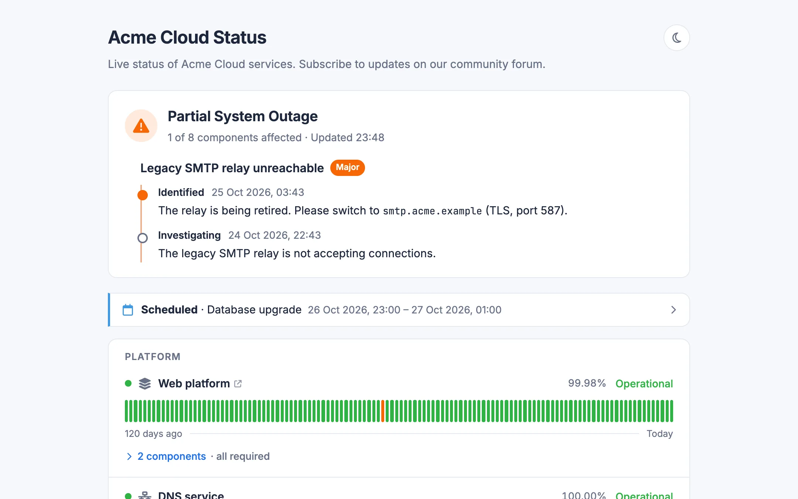

<p align="center">
  <picture>
    <source media="(prefers-color-scheme: dark)" srcset="branding/statora-logo-dark.svg">
    
  </picture>
  <br><br>
  <a href="https://github.com/timothestoifl24/statora/releases/latest"></a>
  <a href="https://hub.docker.com/r/timothestoifl24/statora"></a>
  <a href="LICENSE"></a>
</p>

Statora is self-hosted uptime monitoring with public status pages. It comes as one container image,
plus PostgreSQL and Redis: watch your services, group them the way they really depend on each other,
and tell your users what's going on.

- [Quick Setup](#quick-setup)
- [Full Setup](https://statora.timothestoifl24.dev/setup/)
- [Guide](https://statora.timothestoifl24.dev/guide/)
- [Screenshots](https://statora.timothestoifl24.dev/screenshots)

<p align="center">
  <picture>
    <source media="(prefers-color-scheme: dark)" srcset="docs/public/screenshots/status-page-dark.webp">
    
  </picture>
</p>

<a href="https://ko-fi.com/Z4F028KJ68"></a>

## Features

- HTTP(S), TCP, ping, DNS and SQL monitors, with retries and a latency threshold for *degraded*
- Stack and redundancy groups that model how your services depend on each other
- As many public status pages as you like, each with its own accent colour, logo and favicon
- Incidents with Markdown timelines, and maintenance windows that don't count as downtime
- Admin panel based on [Tabler](https://tabler.io), with a dashboard, wallboard and page builder
- Single sign-on with LDAP / Active Directory, OAuth2 / OpenID Connect and SAML 2.0
- REST API (OpenAPI 3.1) with API tokens, ready for Terraform

## Quick Setup

1. [Install Docker](https://docs.docker.com/get-docker/)
2. Download the Compose file and the example settings:

```bash
curl -fsSLO https://raw.githubusercontent.com/timothestoifl24/statora/main/docker-compose.yml
curl -fsSL https://raw.githubusercontent.com/timothestoifl24/statora/main/.env.example -o .env
```

3. Set `STATORA_SECRET_KEY`, `POSTGRES_PASSWORD` and `STATORA_BASE_URL` in `.env`
4. Bring up your stack by running

```bash
docker compose up -d
```

5. Open [http://localhost:8000](http://localhost:8000) and create the admin account

This is the bare minimum. See the [documentation](https://statora.timothestoifl24.dev/setup/) for HTTPS,
Kubernetes, backups and the [configuration reference](https://statora.timothestoifl24.dev/reference/configuration).

## Contributing

Pull requests are welcome against the `develop` branch; official releases are made from `main`.
Please read [CONTRIBUTING.md](CONTRIBUTING.md) and the [Code of Conduct](CODE_OF_CONDUCT.md) first.
How to run Statora locally is described under [development](https://statora.timothestoifl24.dev/reference/development).

Documentation for `develop` is available for preview at
[statora.timothestoifl24.dev/dev](https://statora.timothestoifl24.dev/dev/).

## Getting Support

1. [Found a bug?](https://github.com/timothestoifl24/statora/issues)
2. [Found a vulnerability?](https://github.com/timothestoifl24/statora/security/advisories/new) See [SECURITY.md](SECURITY.md).

## License

Statora is released under the [MIT License](LICENSE). Third-party components are listed in [THIRD_PARTY_LICENSES.md](THIRD_PARTY_LICENSES.md).
